# Athera Talks

Real-time chat and browser voice calls for anime fans. Created by Taha Ahsan.

Sign in with email or Google, search a username, and talk one to one. A voice button in the chat starts a WebRTC call. Profiles hold a username, an avatar, and a favourite anime.

If Supabase keys are missing, the app shows a setup screen instead of crashing. **Preview the demo** walks through the whole interface with sample fans stored in this browser.

## Features

- Email sign up and sign in, with a session that survives refresh
- Sign up asks for a username and checks that it is free
- Continue with Google (Supabase OAuth), disabled with an explanation until you turn it on
- Forgot-password email, then a screen to choose a new password
- Sign out from the chat list and from the profile page
- One-to-one chat: search, conversation list, timestamps, read check marks
- Voice calls: start, incoming accept or decline, mute, hang up, call timer
- Profile: username, avatar upload, favourite anime
- Dark theme by default, plus a Naruto night-village theme (navy, lantern orange, geometric kunai) saved in this browser

## Screenshots

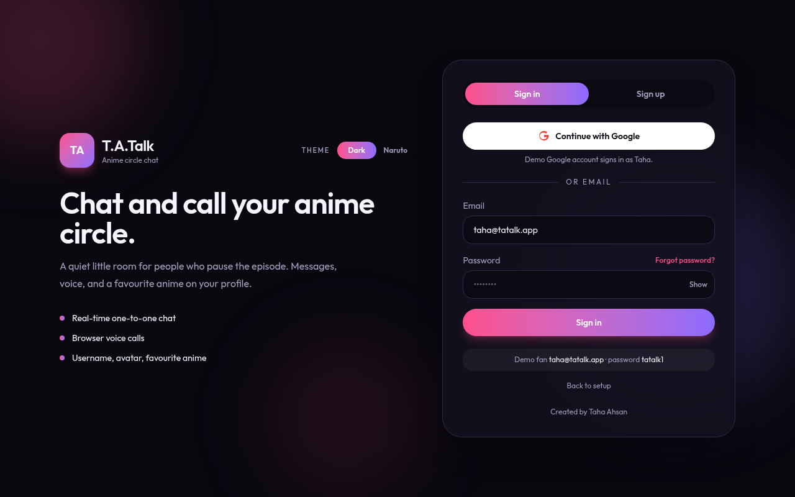

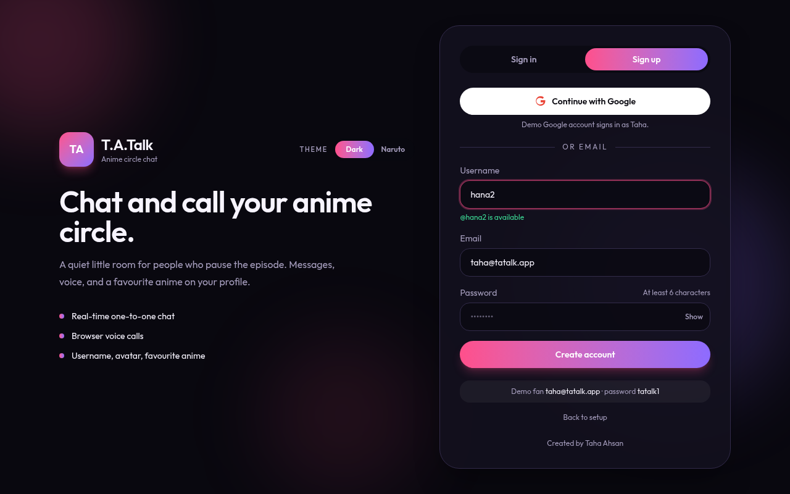

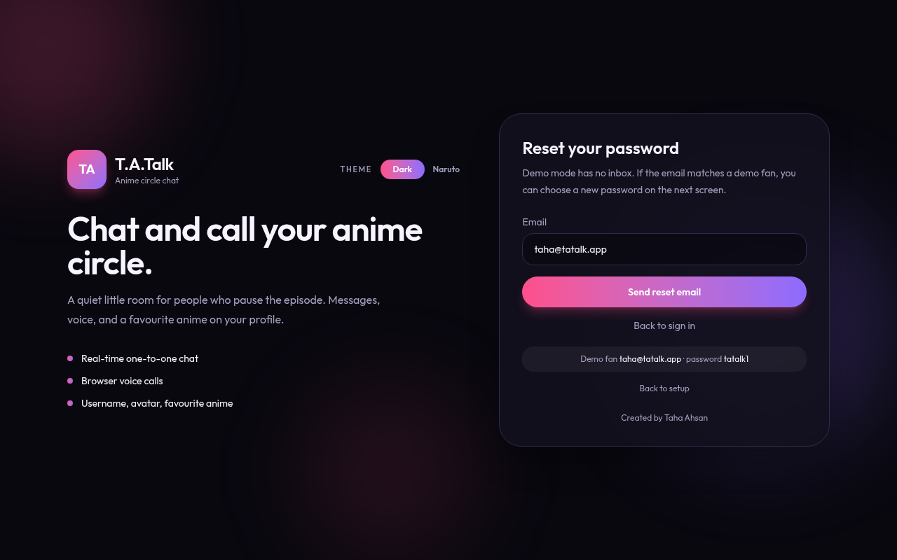

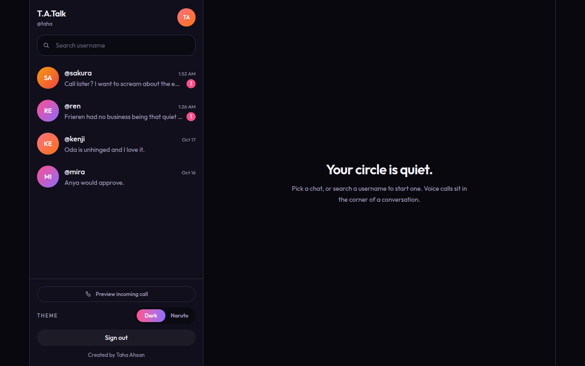

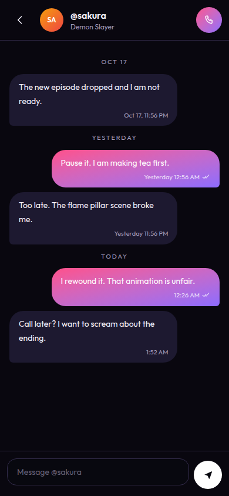

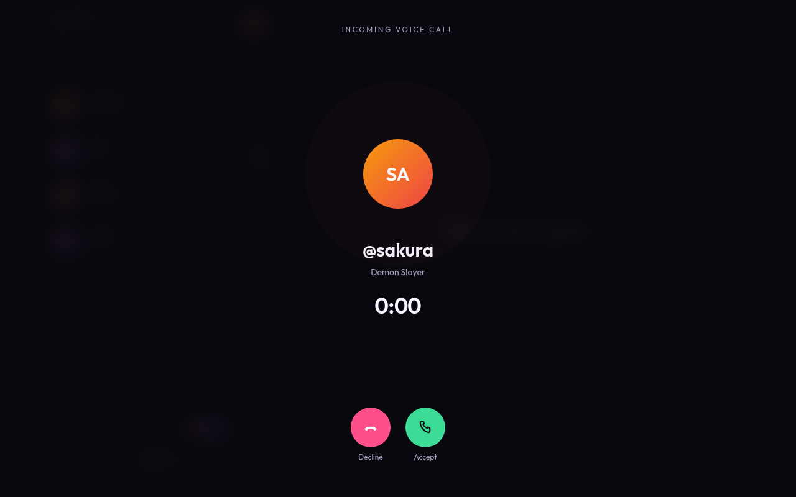

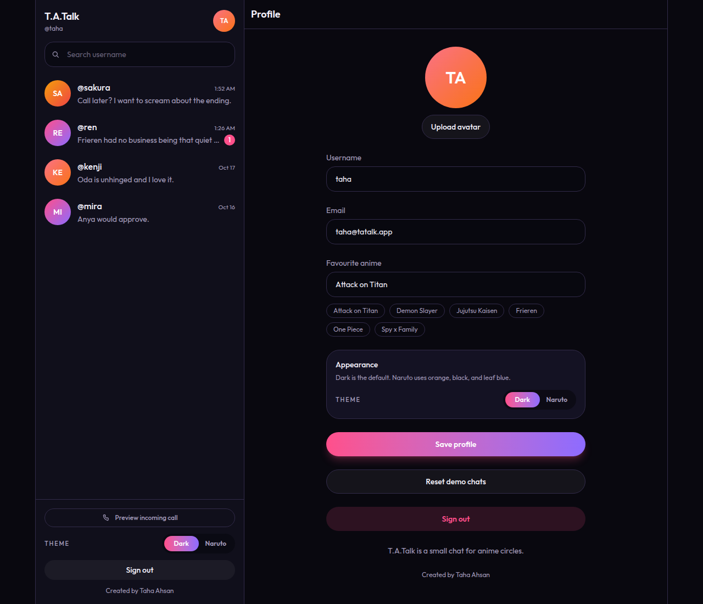

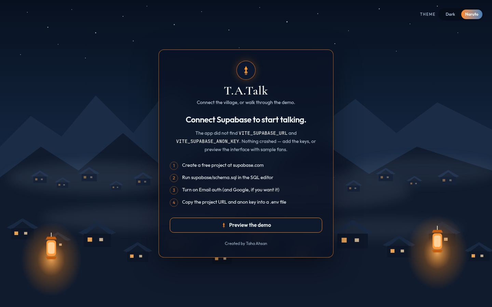

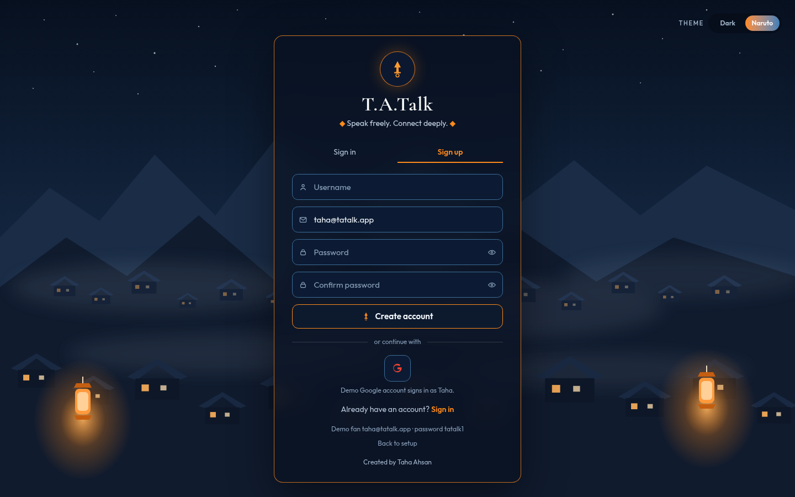

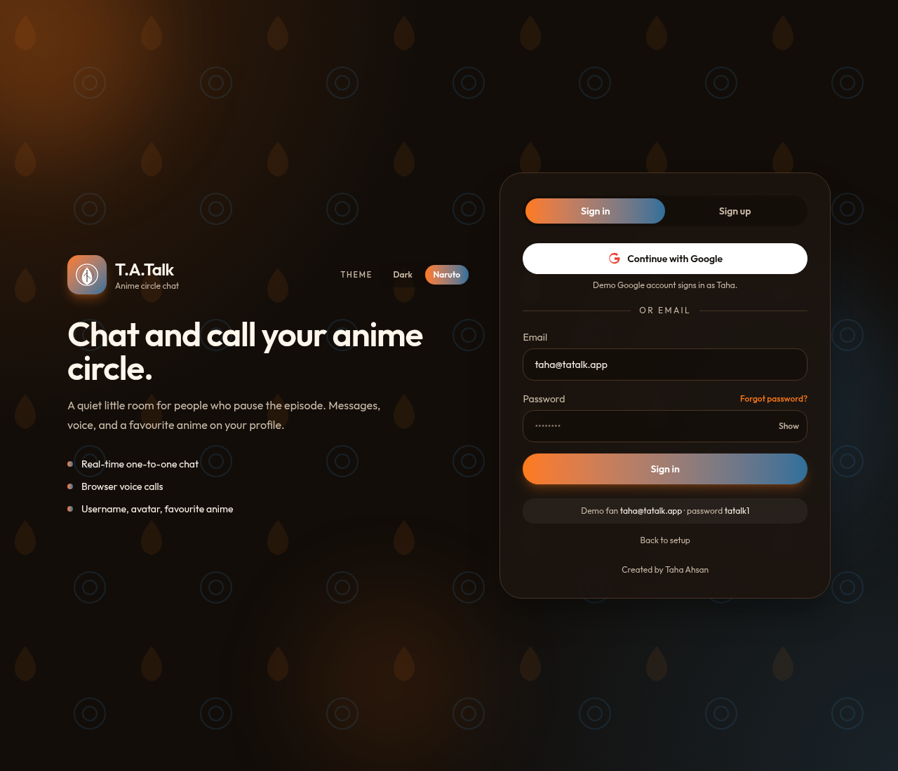

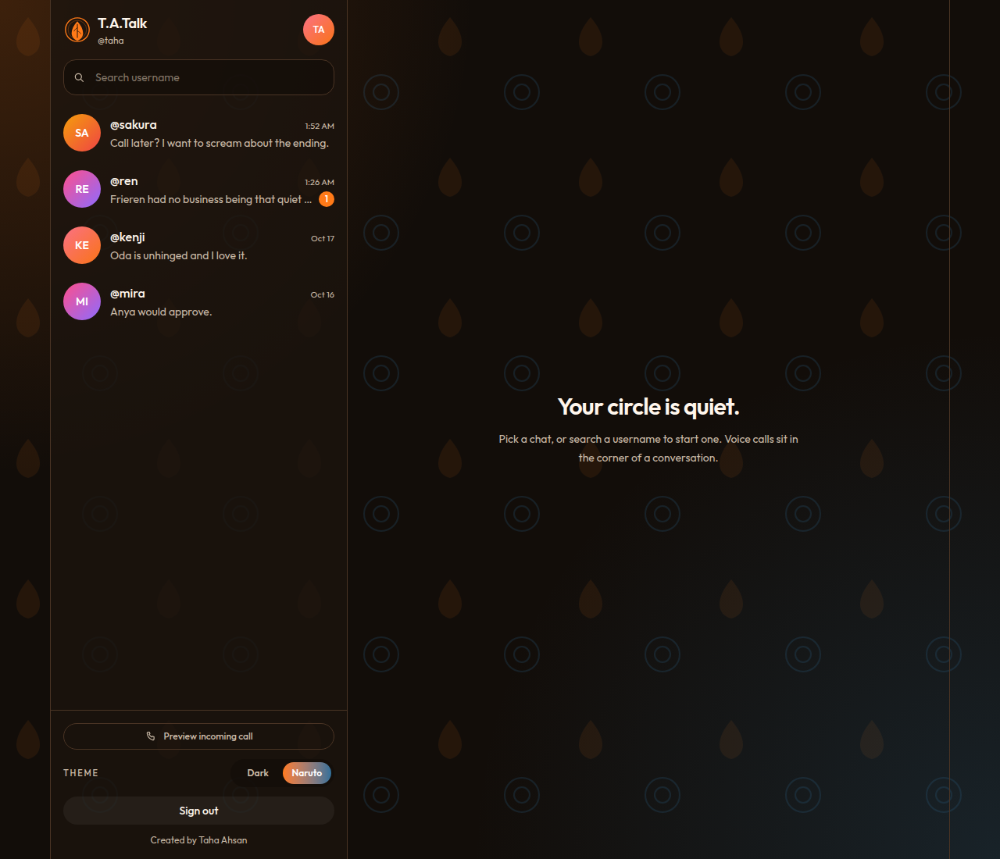

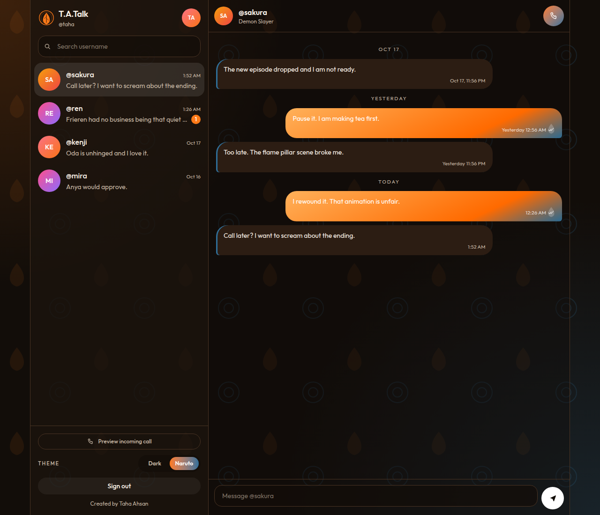

## Folder structure

```text
src/
  components/     shared UI (sidebar, chat thread, call screen, setup)
  context/        session, chat list, and the voice-call state
  demo/           sample fans used when Supabase is not configured
  lib/            small helpers (time, username rules, WebRTC, Supabase client)
  pages/          landing auth, reset password, home, profile
  services/       live Supabase queries and call signaling
supabase/schema.sql
.github/workflows/   CI plus GitHub Pages deploy
```

## Create a Supabase project

1. Create a free project at [supabase.com](https://supabase.com).
2. Wait until the database is ready.
3. Open **SQL Editor → New query**, paste the whole of `supabase/schema.sql`, and run it.
4. The script creates `profiles`, `conversations`, `conversation_members`, and `messages`, indexes, Row Level Security, the signup trigger, Realtime for `messages`, and a public `avatars` bucket.

You only read and update your own profile row. Chats and messages are limited to members. Search and the chat list use small database functions that return a username, avatar, and favourite anime — nothing else.

### Email auth

1. Open **Authentication → Providers → Email** and leave it enabled.
2. Leave **Confirm email** off. New accounts are confirmed on the server, and sign-up opens the app. There is no confirmation email.
3. Under **Authentication → URL configuration**, set **Site URL** to `http://localhost:5173` while you develop.
4. Add these **Redirect URLs**:
   - `http://localhost:5173/**`
   - `https://<github-username>.github.io/ta-talk/**` (if you use GitHub Pages)
   - Your Vercel URL with `/**`, if you use Vercel

The reset-password link brings people back to `/reset-password`. The wildcard above covers that path.

### Google sign-in

The **Continue with Google** button stays disabled until you opt in. That way a project without Google configured does not fail on click. The demo always enables a pretend Google account so you can preview the button.

1. In [Google Cloud Console](https://console.cloud.google.com/), create an OAuth client:
   - **APIs & Services → OAuth consent screen**. External is fine. Add yourself as a test user while the app is in testing.
   - **Credentials → Create credentials → OAuth client ID → Web application**.
   - Authorized JavaScript origins: `http://localhost:5173` and your production origin (no path).
   - Authorized redirect URI: `https://<project-ref>.supabase.co/auth/v1/callback`
     Find `<project-ref>` in Supabase → **Project Settings → General**.
2. In Supabase, open **Authentication → Providers → Google**. Turn it on and paste the client ID and client secret.
3. Confirm the redirect URLs from the email section are saved. Google returns to Supabase, then Supabase returns to your Site URL.
4. In `.env` set:

   ```bash
   VITE_SUPABASE_GOOGLE_ENABLED=true
   ```

5. Restart `npm run dev`.
6. For GitHub Pages, add a repository secret named `VITE_SUPABASE_GOOGLE_ENABLED` with the value `true`, next to the two Supabase secrets below.

Leave the flag unset or `false` and the button stays disabled, with a short note on the landing page.

### Copy the API keys

1. Open **Project Settings → API**.
2. Copy the **Project URL** and the **anon public** key.
3. In this repo:

   ```bash
   cp .env.example .env
   ```

4. Paste the real values into `.env`:

   ```bash
   VITE_SUPABASE_URL=https://YOUR-PROJECT.supabase.co
   VITE_SUPABASE_ANON_KEY=your-anon-key
   VITE_SUPABASE_GOOGLE_ENABLED=false
   ```

The anon key is meant for the browser. Row Level Security is what keeps data private. Do not put the service-role key in `.env` or in the frontend.

## Run it locally

```bash
npm install
npm run dev
```

Open `http://localhost:5173`.

| Script | What it does |
| --- | --- |
| `npm run dev` | Local app |
| `npm test` | Unit tests |
| `npm run lint` | ESLint |
| `npm run build` | Typecheck and production build |
| `npm run preview` | Serve the build |

## Demo mode

With no `.env` (or with the placeholder values still in place), the first screen explains how to connect Supabase. **Preview the demo** stores a sample circle in `localStorage`.

- Sign in as `taha@tatalk.app` / `tatalk1`, or sign up with a new username
- **Continue with Google** signs in as Taha
- **Forgot password?** lets you set a new demo password on the next screen (no email is sent)
- Sign out, refresh, and the session is still there
- **Preview incoming call** on the chat list opens the accept / decline screen
- **Reset demo chats** on the profile puts the sample messages back

Nothing in demo mode is stored on a server.

## Themes

The setup screen, landing page, chat list, and profile include a **Dark / Naruto** switch. Dark is the plain sakura and violet look. With Naruto selected, the missing-keys setup card and the sign-in / sign-up pages share a night-village scene: original mountain and roof silhouettes, mist, lantern glow, a glass card with an orange edge, and a geometric kunai mark. Chat uses the same night navy and lantern orange. The choice is stored in `localStorage` under `tatalk:theme`, so a refresh keeps it. The village, lanterns, and kunai are original SVG and CSS, not official artwork.

## How chat and calls work

Chat writes a row in `messages`. The browser listens on Supabase Realtime for inserts in conversations you belong to.

A voice call does not go through a media server. Each browser opens a WebRTC peer connection and exchanges the offer, answer, and network candidates on a Realtime broadcast channel named `inbox:<user id>`. Both people need Athera Talks open. Google STUN finds a direct path. When that path is still down after a few seconds, the caller retries through TURN and the screen says it is retrying via relay. If the call is still down after 25 seconds, it stops with a clear failure. Details lists the ICE candidate types that were gathered (`host`, `srflx`, `prflx`, `relay`) and the path that was selected.

The relay credentials come from the `turn-credentials` Edge Function, which asks Cloudflare Realtime for a short-lived set that includes TURN over TCP and `turns:` on port 443. The Cloudflare API token stays in the function secrets `CF_TURN_KEY_ID` and `CF_TURN_API_TOKEN`. Credentials last about 24 hours. It is not a `VITE_` variable. Set `VITE_TURN_URLS=none` to stay on STUN only, or set `VITE_TURN_URLS`, `VITE_TURN_USERNAME`, and `VITE_TURN_CREDENTIAL` to point a local build at another relay. The call screen shows Calling, Ringing, Connecting, Connected, or Call failed with the reason. A blocked microphone is reported on that screen. The call timer, mute, and hang-up controls still work in the demo without a microphone. Signaling does not use a database table, so no extra SQL is required. `public.messages` is already in the `supabase_realtime` publication.

## Deploy to GitHub Pages

The workflow in `.github/workflows/deploy.yml` builds with Vite base `/ta-talk/` and deploys the `dist` folder. A copy of `index.html` is saved as `404.html` so routes like `/c/...` still open the app.

1. Push the repo to GitHub. The repository name should be `ta-talk`. If you use another name, change `VITE_BASE_PATH` in the workflow and the base path in this README.
2. In the repo, open **Settings → Secrets and variables → Actions** and add:
   - `VITE_SUPABASE_URL`
   - `VITE_SUPABASE_ANON_KEY`
   - `VITE_SUPABASE_GOOGLE_ENABLED` (`true` or `false`)
3. Open **Settings → Pages → Build and deployment → Source** and choose **GitHub Actions**.
4. Merge to `main`. The **Deploy to GitHub Pages** workflow publishes the site.
5. Add `https://<github-username>.github.io/ta-talk/**` to the Supabase redirect URLs.

The build step passes repository secrets `VITE_SUPABASE_URL` and `VITE_SUPABASE_ANON_KEY` into Vite (project `jvjgouivqzklfzshmdti`). When those are set, the published site opens real Sign in / Sign up and does not offer **Preview the demo**. If the secrets are missing, the Pages build still succeeds and the site opens the setup screen.

## Deploy to Vercel

1. Import the GitHub repo. Framework preset: Vite.
2. Add the same three environment variables. Do **not** set `VITE_BASE_PATH` (Vercel serves the site from `/`).
3. Deploy. `vercel.json` rewrites every path to `index.html` so the router works.
4. Add the Vercel URL to the Supabase redirect allow list.

## Credits

Created by Taha Ahsan.
